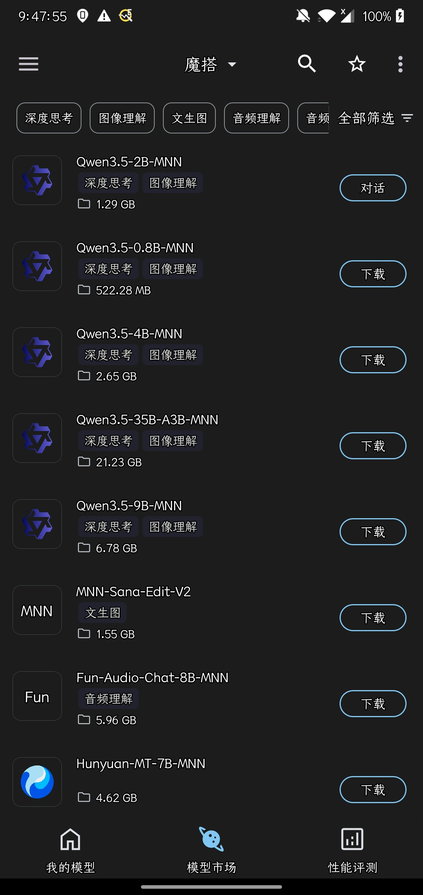
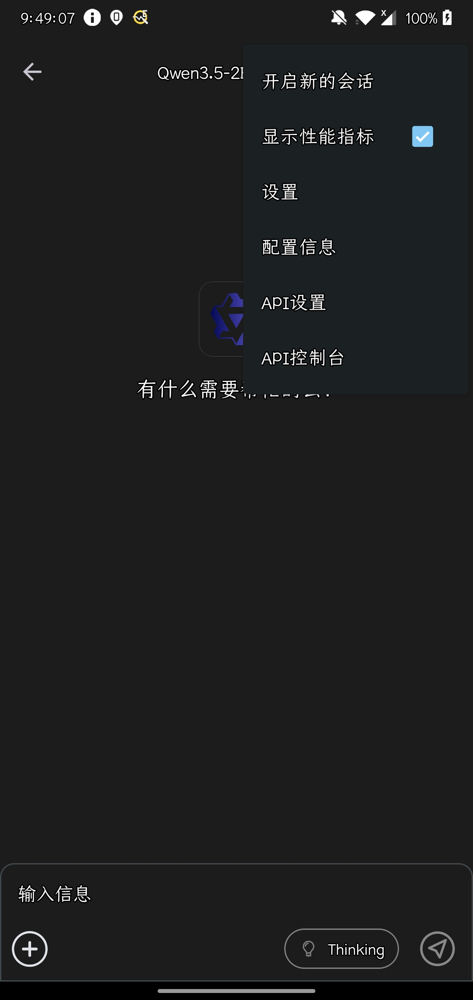
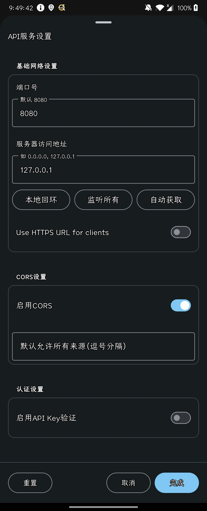

# QQPilot Pocket Edition


---

## 📖 项目简介

QQPilot Pocket Edition（QQPilotPE）是一款运行在 Android 上的全自动 QQ 聊天机器人。它采用**纯视觉方案**完成收发消息，全程不调用 QQ 内部接口、不注入 DLL，尽量避免触发客户端的风险检测。

### ⚙️ 工作原理

> **OpenCV 检测红点** → **点击会话** → **解析屏幕消息** → **生成回复**（内置数据集 / MNN / OpenAI 兼容 API）→ **输入内容** → **点击“发送”**

### ⚠️ 重要安全提示

- 本项目基于 [Autox.js v6_ozobi](https://github.com/ozobiozobi/Autoxjs_v6_ozobi) 开发，安全性虽不如 [Linux](https://github.com/QQPilotOrganization/QQPilotLinux/) / [Windows](https://github.com/QQPilotOrganization/QQPilot) 版本，但**仍然相对安全**。
- **无需修改 QQ 客户端**，**无需 Root 权限**。
- 自动化操作仍存在账号风险，建议使用小号测试，并妥善保管 API Key。

### 🚫 当前限制

- 运行时**独占手机前台**，请保持 QQ 在最前方并关闭锁屏。
- 图片解析（把聊天图片作为视觉模型输入）为实验性功能，暂不支持主动发送图片。
- “内置模型”不是大语言模型，而是脚本内置的**离线问答数据集**，通过二元组 Jaccard 相似度匹配答案；覆盖面有限，问题超出数据集时会返回固定兜底语句。
- 仅适配“简洁模式 + 极简白”的 QQ 界面，其他主题可能导致控件解析失败。

---

## 📱 设备要求

| 配置等级     | Android 版本 | RAM | ROM  |
| :----------- | :----------- | :-- | :--- |
| **最低配置** | Android 7+   | 4GB | 4GB  |
| **建议配置** | Android 10+  | 8GB | 16GB |

使用本地模型时，请根据模型大小额外预留内存与存储空间。

---

## 🛠️ 安装与配置

### 1. QQ 客户端设置（必须）

为保证视觉识别与控件解析的准确率，请按以下要求配置 QQ：

- **模式选择**：简洁模式
- **主题色**：极简白
- **特别关心**：关闭所有特别关心功能
- **色彩滤镜**：保持关闭状态
- 关闭会遮挡聊天界面的悬浮窗、红包助手等插件

### 2. 选择回复方式

在 `QQPilot设置` 中选择一种模式：

| 模式         | 说明                                                                 | 是否需要网络 |
| :----------- | :------------------------------------------------------------------- | :----------- |
| **mnn**      | 连接本机 MNN Chat 的 OpenAI 兼容服务，自动读取 `/v1/models` 中的模型 | 本机服务     |
| **内置模型** | 使用脚本内置的离线问答数据集，零配置、零网络                         | 否           |
| **其他**     | 连接任意 OpenAI 兼容 API（OpenAI、DeepSeek、Ollama、One API 等）     | 是           |

> `mnn` 模式会自动请求 `http://localhost:8080/v1/models` 并选择第一个模型；如果服务未启动，会回退到设置中填写的模型名。

#### 以 MNN Chat + Qwen3.5-2B-MNN 为例

1. **下载模型**：在 MNN Chat 中下载 `Qwen3.5-2B-MNN`。
   

2. **进入设置**：在“我的模型”选项卡中选择已下载的模型，点击左上角进入设置。
   

3. **参数配置**：参照下图完成配置后，**务必重启模型服务**。
   

4. 在 `QQPilot设置` 中选择 **mnn**，保存即可。

#### 使用其他 OpenAI 兼容 API

选择 **其他**，然后填写：

- **模型名称**：例如 `deepseek-chat`、`gpt-4o-mini`、`qwen2.5:7b`
- **服务器地址**：不带 `/chat/completions`，例如 `https://api.deepseek.com/v1`
- **APIKEY**：对应服务的密钥（本地 Ollama 可随意填写）

### 3. 设置项说明

打开 `QQPilot设置` 后，所有设置项都在可滚动页面中，右上角“保存”按钮始终可见。

| 设置项           | 说明                                                               |
| :--------------- | :----------------------------------------------------------------- |
| 模型             | 选择 `mnn`、`内置模型` 或 `其他`                                   |
| 模型名称         | `其他` 模式必填；`mnn` 模式会自动覆盖                               |
| 服务器地址       | OpenAI 兼容接口的 Base URL，仅 `其他` 模式有效                     |
| APIKEY           | 接口密钥                                                           |
| 图片模型         | 是否把截图作为图片输入（实验性，需模型支持视觉）                   |
| 解析图片数       | 每次最多解析的图片数量                                             |
| 滑动次数         | 向上/向下翻动聊天记录的次数，消息越多越需要增大                    |
| 发完消息后等待   | 每条回复发送后的等待秒数，避免刷屏                                 |
| 最大输出字数     | 单条回复截断长度                                                   |
| 系统提示词       | 角色设定与输出格式要求，输入框已扩展为多行                         |

设置保存在手机上的：

```text
/storage/emulated/0/Download/qqpilotconfig.json
```

升级脚本后旧配置会自动合并默认值，不会因为缺少新字段而崩溃。

### 4. 安装与启动

1. 确保手机已安装 QQ 客户端。
2. 前往 [Releases](../../releases) 页面下载并安装 `QQPilot` 与 `QQPilot设置` APK。
3. 打开 `QQPilot设置`，按需调整参数并保存。
4. 打开 `QQPilot` 主程序，授予**无障碍权限**与**截图权限**，点击“立即开始”。

🎉 **配置完成！机器人将自动接管消息回复。**

---

## 🧑‍💻 开发者指南

### 项目结构

```text
QQPilotPocketEdition/
├── QQPlilot.js        # 主脚本：视觉识别、消息解析、模型调用、发送
├── option/            # 设置 App
│   ├── option.js
│   └── project.json
├── assets/            # 图标与界面资源
├── tutorial/          # MNN Chat 配置教程截图
├── test/              # 调试脚本（截图、图片 Base64 等）
├── config.json        # 配置示例
├── project.json       # 主项目信息
└── README.md
```

`ref/Autox_ozobi_Docs/` 为本地 Autox.js 参考文档，已在 `.gitignore` 中忽略，不随仓库提交。

### 核心逻辑

- **`QQPlilot.js` 顶部**（约第 45–2702 行）是内置问答数据集 `dataset`，键为问题、值为答案。可以按同样格式继续补充。
- **`answerJaccard()`** 使用二元组 Jaccard 相似度寻找最接近的问题；内置模式只取当前最后一条消息进行匹配。
- **`getAnswer()`** 负责组装 OpenAI 格式请求，通过 OkHttp 发送，超时时间由配置中的 `timeout` 控制。
- **主循环**通过检测 `#FA4C2D` 红点进入会话，滚动读取 `TextView`，再根据控件数量分类出发送者与消息内容。

### 修改与打包

1. 用 Autox.js v6_ozobi 导入 `QQPlilot.js` 或整个项目。
2. 修改后先在真机运行 `test/test.js`，确认截图、控件查找正常。
3. `option/` 是独立的设置 App 项目，修改后在 Autox.js 中单独打包。
4. 版本号在 `project.json` 与 `option/project.json` 中同步修改。

### 常见问题

- **内置模型总是回复兜底语句**：说明问题没有匹配到数据集条目；请在 `dataset` 中补充问答，或切换到 MNN / 外部 API。
- **提示“未找到QQ”**：确认已安装 QQ，且 `getPackageName("QQ")` 能解析到包名。
- **一直提示 timeout**：检查服务地址、API Key、模型名，以及手机是否能访问该地址；本地服务需与手机在同一网络。
- **找不到“发送”按钮**：QQ 必须使用简洁模式与极简白主题。

---

## 🤝 贡献与反馈

我们欢迎任何形式的贡献！

- 🐞 **发现 Bug** → 提交 [Issue](https://github.com/QQPilotOrganization/QQPilotPocketEdition/issues)
- 💡 **功能改进** → 提交 Pull Request
- 🌍 **语言/模型建议** → 欢迎在 Issue 中讨论

> 让我们一起打造更安全、智能的视觉自动化工具！

---

## 📄 开源协议

- **代码**：采用 [GPL-2.0 License](LICENSE)
- **图片资源**：遵循 [QQPilot Windows 版本](https://github.com/QQPilotOrganization/QQPilot) 许可证
