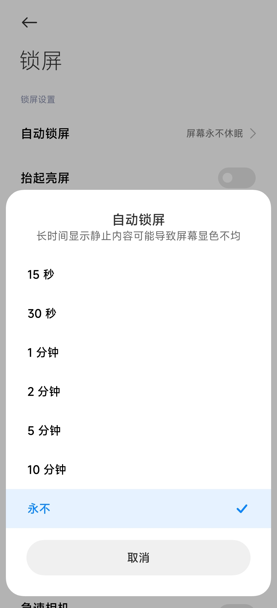
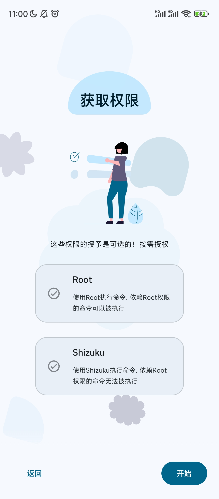
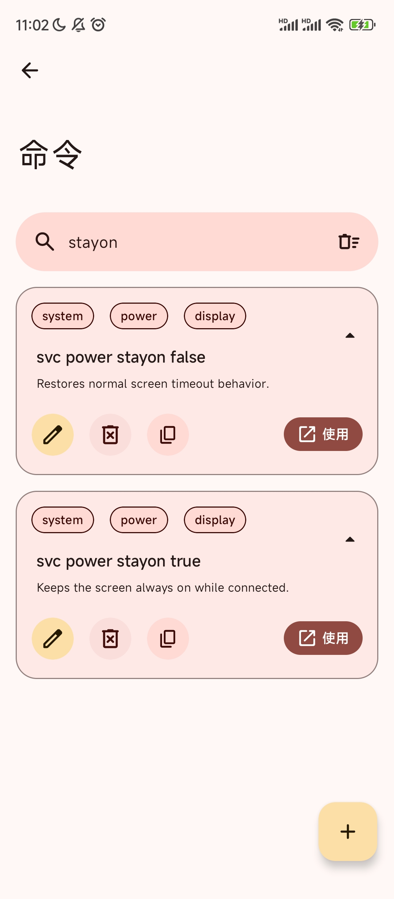
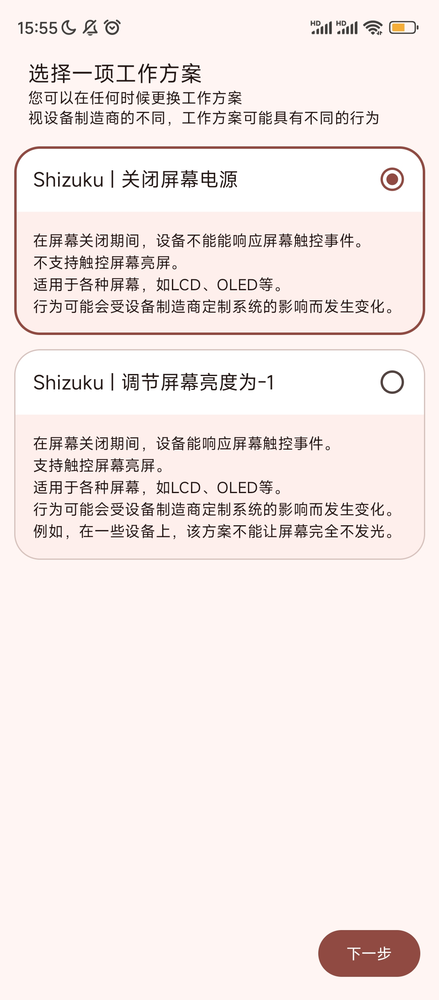

## 下面的教程似乎不可用

推荐在开发人员选项中打开`充电不熄屏`代替

## 模拟熄屏使用

>[!error] 这本质上其实是模拟熄屏，手机实际尚未锁定!

>[!info] 需要准备以下程序
>[Shizuku](https://github.com/RikkaApps/Shizuku/releases)
>[Extinguish](https://github.com/Moderpach/Extinguish/releases/download/0.9.5.1/app-release.apk)

### 1、按照Shizuku并配置

https://shizuku.rikka.app/zh-hans/guide/setup/#%E5%90%AF%E5%8A%A8-shizuku

一般使用"通过无线调试启动"。

### 2、设置永不熄屏
在设置里面（关键词：锁屏/屏幕/显示/休眠）设置

<b>若手机无法设置永不休眠:</b>

>[!info] 需要额外准备以下程序
>[aShellYou](https://github.com/DP-Hridayan/aShellYou/releases)

在aShellYou内，一直下一步直到

选择Shizuku即可。

接下来，选择本地ADB，点击  。

在搜索框内输入`stayon`

`svc power stayon false`即关闭屏幕常亮,若以后想要关闭屏幕常亮,，执行该操作。
`svc power stayon true`即开启屏幕常亮

选择使用，点击

### 完成!

### 2.配置Extinguish
同意许可后，进入"选择一项工作方案"界面
两个方案都不会影响正常运行。

点击同意悬浮窗权限后，点击即进入熄屏。

>[!info] 点击两次电源键退出熄屏

>[!info] 在打开QQPilot Pocket Edition且进入QQ后，再点击
