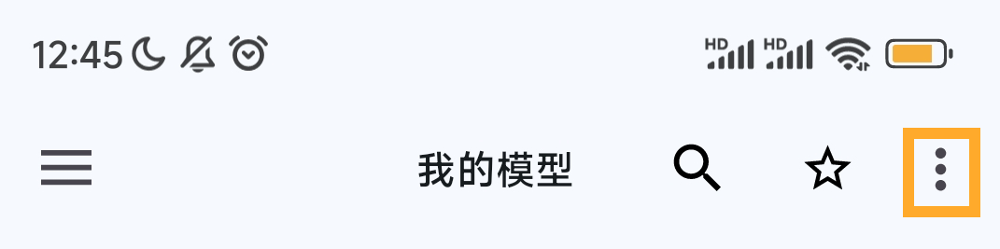
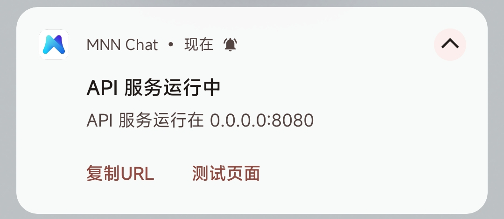

## 🛠️ 安装与配置


>[!important] 1. QQ 客户端设置（必须）
>
>为保证视觉识别与控件解析的准确率，**请按以下要求配置 QQ**：
>
>- **模式选择**：简洁模式
>- **主题色**：极简白
>- **特别关心**：关闭所有特别关心功能
>- **色彩滤镜**：保持关闭状态
>- 关闭会遮挡聊天界面的悬浮窗、红包助手等插件

>[!info] 熄屏使用
> 可以模拟熄屏使用，详见[这里](/tutorial/black.md)

### 2. 安装

1. 确保手机已安装 QQ 客户端。
2. 前往 [Releases](../../releases) 页面下载并安装 `QQPilot` 与 `QQPilot设置` APK。

3. 打开 `QQPilot设置`，按需调整参数
### 3. 设置项说明

打开 `QQPilot设置` 后，所有设置项都在可滚动页面中，右上角“保存”按钮始终可见。

| 设置项           | 说明                                                               |
| :--------------- | :----------------------------------------------------------------- |
| 模型             | 选择 `mnn` 或 `其他`                                   |
| 模型名称         | `其他` 模式必填；`mnn` 模式会自动覆盖                               |
| 服务器地址       | OpenAI 兼容接口的 Base URL，仅 `其他` 模式有效                     |
| APIKEY           | 接口密钥                                                           |
| 图片模型         | 是否把截图作为图片输入（实验性，需模型支持视觉）                   |
| 解析图片数       | 每次最多解析的图片数量                                             |
| 滑动次数         | 向上/向下翻动聊天记录的次数，消息越多越需要增大                    |
| 发完消息后等待   | 每条回复发送后的等待秒数，避免刷屏                                 |
| 最大输出字数     | 单条回复截断长度                                                   |
|休息时间表|设定时间（小时）内不工作|
| 系统提示词       | 角色设定与输出格式要求，输入框已扩展为多行                         |
|远程服务器超时(ms)|服务器超时时间，单位ms。1s=1000ms，本地模型可以设置长一点|

设置保存在手机上的：

```text
/storage/emulated/0/Download/qqpilotconfig.json
```

升级脚本后旧配置会自动合并默认值，不会因为缺少新字段而崩溃。

#### 选择回复方式

在 `QQPilot设置` 中选择一种模式：

| 模式         | 说明                                                                 | 是否需要网络 |
| :----------- | :------------------------------------------------------------------- | :----------- |
| **mnn**      | 连接本机 MNN Chat 的 OpenAI 兼容服务，自动读取 `/v1/models` 中的模型 | 本机服务     |
| **其他**     | 连接任意 OpenAI 兼容 API（OpenAI、DeepSeek、Ollama、One API 等）     | 是           |

> `mnn` 模式会自动请求 `http://localhost:8080/v1/models` 并选择第一个模型；如果服务未启动，会回退到设置中填写的模型名。

<details> 

<summary><b>模型的配置和选择</b></summary>

#### 以 MNN Chat + Qwen3.5-2B-MNN 为例

1. 下载 [MNN Chat](https://github.com/alibaba/MNN/blob/master/apps/Android/MnnLlmChat/README_CN.md#releases)

2. 确保在`MNN Chat`设置内
<div align="center">


在这里打开设置
</div>

将下载提供商设置为魔搭。
3. **下载模型**：在 `MNN Chat`  中下载 `Qwen3.5-2B-MNN`。
   

2. **进入设置**：在“我的模型”选项卡中选择已下载的模型，点击左上角进入设置。
   

3. **参数配置**：参照下图完成配置后，**务必重启模型服务**。
   

<div align="center">


确保通知栏可以显示<b>API服务运行中</b>
</div>

4. 在 `QQPilot设置` 中选择 **mnn**，保存即可。

#### 使用其他 OpenAI 兼容 API

选择 **其他**，然后填写：

- **模型名称**：例如 `deepseek-flash`、`qwen3.8:27b`
- **服务器地址**：不带 `/chat/completions`，例如 `https://api.deepseek.com/v1`
- **APIKEY**：对应服务的密钥（本地 Ollama 可随意填写）

</details>


### 最后
4. 打开 `QQPilot` 主程序，授予**无障碍权限**与**截图权限**，点击“立即开始”。


### 🎉 **配置完成！机器人将自动接管消息回复。**

